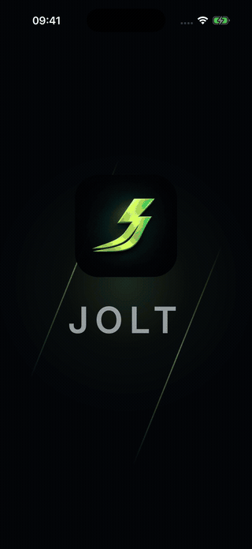
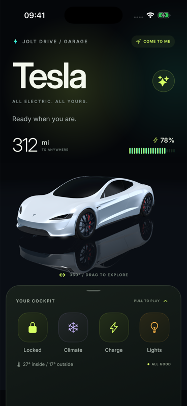
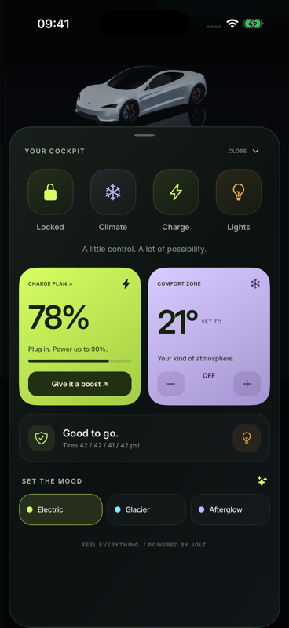
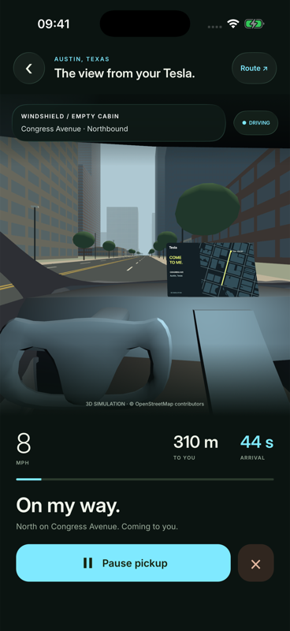
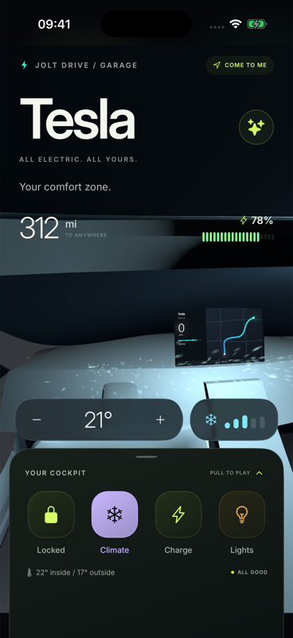
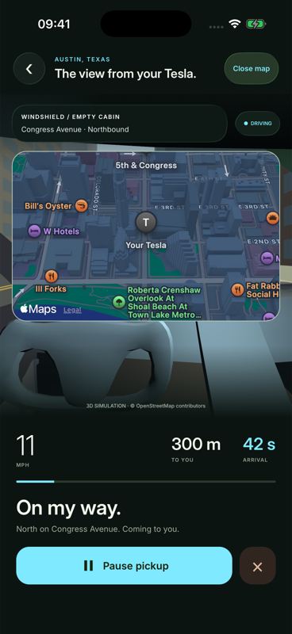

<p align="center">
  
</p>

<h1 align="center">Jolt Drive</h1>

<p align="center">
  A Tesla-inspired iOS app. Built with NativeScript, Vue, and Jolt.
</p>

<p align="center">
  <a href="https://jolt.rafaelaugusto.dev/">Jolt</a> ·
  <a href="https://vue-router-ns.rafaelaugusto.dev/">Vue Router NS</a> ·
  <a href="#run-it">Run it</a>
</p>

<p align="center">
  
</p>

Drag the car around. Pull up the cockpit. Turn on the climate and watch the camera move into the cabin. Then call the car over for a short drive through downtown Austin.

The car is a SceneKit scene, the route is drawn with MapKit, and the controls are native views. Jolt connects the gestures, springs, camera, lights, and materials. Vue handles the screen state.

## Take a look

<p align="center">
  
  
  
</p>

<details>
<summary>Cabin controls and the route map</summary>

<p align="center">
  
  
</p>

</details>

- **Garage:** orbit the model, flash the headlights, lock the car, or replay its entrance.
- **Cockpit:** a draggable panel whose position also changes the camera framing. Charging has its own sheet, with 80%, 90%, and 100% targets.
- **Cabin:** move from the exterior view to the driver’s seat. Temperature and fan controls sit over the scene; the vents respond to the fan setting.
- **Atmosphere:** three palettes, animated gradients, and spring-driven selection states.
- **Pickup:** a simulated drive along Congress Avenue, from 2nd Street toward 5th. Switch between the cabin and the map, pause, resume, or cancel.

This is an interactive demo. Battery, temperature, locks, and pickup are simulated in memory. It does not connect to a vehicle or Tesla’s APIs, and it is not affiliated with Tesla.

## Run it

You need macOS, Node.js, the NativeScript CLI, Xcode with an iOS simulator, and CocoaPods. The [NativeScript macOS setup guide](https://docs.nativescript.org/setup/macos) covers the toolchain.

```sh
git clone https://github.com/rafaelaugustos/jolt-drive.git
cd jolt-drive
npm ci
npm run ios
```

To choose a simulator or a connected iPhone:

```sh
npm run ios -- --device <device-id>
```

The model, textures, fonts, and generated icons are included. You do not need Blender or an API key to run the app. The 3D Austin scene uses bundled geometry; the MapKit basemap needs a network connection.

The supported target is **iOS**. The native bundle identifier is currently `org.nativescript.joltcar`; the display name is **Jolt Drive**. Configure signing in Xcode if you run it on a physical device.

Verified locally with Node.js 20.19.4, NativeScript CLI 9.1.2, Xcode 27.0, and an iPhone 17 Pro simulator running iOS 26.2.

## Stack

| Dependency                   | Version       | Used for                                                   |
| ---------------------------- | ------------- | ---------------------------------------------------------- |
| `@nativescript/core`         | `9.1.3`       | Native views and access to iOS APIs                        |
| `nativescript-vue`           | `3.1.2`       | Components and reactive screen state                       |
| `@rafaelaugusto/jolt`        | `0.1.0-rc.10` | Motion values, springs, gestures, text, and effects        |
| `@rafaelaugusto/jolt-native` | `0.1.0-rc.10` | Native animation support                                   |
| `vue-router-ns`              | `0.1.0-rc.4`  | Page navigation, transitions, and returning pickup results |
| `@nativescript/ios`          | `9.1.0`       | iOS runtime                                                |

## Where things live

```text
src/
  pages/
    Splash.vue                 Opening timeline
    Home/
      index.vue                Garage composition and page lifecycle
      useVehicle.ts            Simulated battery and climate
      useCockpitGesture.ts     Panel gestures, snapping, and cancellation
      ControlSheet.vue         Cockpit controls
      EnergyPlan.vue           Charge target sheet
    Summon.vue                 Pickup route entry
  components/
    scene/
      Car3D.vue                Car interaction and camera transitions
      car-stage.ios.ts         Scene assembly and Jolt bindings
      car-model.ios.ts         Model loading, materials, and wheel rig
      car-effects.ios.ts       Studio lights, cabin, vents, and charge port
      scene-kit.ios.ts         Shared native geometry and color helpers
      camera-path.ts           Camera math, independent of the renderer
    summon/
      SummonDrive.vue          Cabin and map presentation
      usePickup.ts             Pickup state, playback, and telemetry
      drive-stage.ios.ts       Driving scene
      route-map.ios.ts         Native MapKit view
      austin-route.ts          Shared route coordinates and timing
  themes/                      Palette and motion presets
  utils/                       Native references and resource lifecycle
tests/                         Geometry, color, vehicle, and disposal tests
scripts/                       Asset preparation
```

The garage and pickup share the same car model. The pickup scene and map share one route function, so their positions stay in sync. UI components delegate vehicle behavior, panel gestures, and pickup playback to separate composables.

## A few implementation details

The splash and car entrance use `seekableTimeline`. The cockpit drives camera framing, gradients, and staggered reveals from one panel offset. Atmosphere options use `springValue`, so a new selection can redirect the current motion.

The charge sheet uses Jolt’s `bottomSheet` and `blur`; the cabin controls use `GlassContainer` and `GlassView`. SceneKit pose, light, material, and shader bindings handle the 3D transitions. Vue Router NS returns the pickup result with `pushForResult`.

Native property owners and their bindings have different lifetimes. Owners stay alive until teardown; bindings live in motion scopes and reconnect after suspension. This matters when a sheet covers the garage or the app comes back from the background. Pickup pauses when the app leaves the foreground. Reduced Motion shortens or skips the larger transitions.

## Working on it

```sh
npm run check       # Formatting, strict TypeScript, and unit tests
npm run format      # Format source and docs
npm test            # Run the tests without an iOS runtime
npm run build:ios   # Compile the native app
```

TypeScript checks unused imports and variables. Prettier keeps the Vue, TypeScript, and test files consistent. The tests cover camera handoffs, route continuity, linear-light emission, charge limits, thermostat behavior, and resource cleanup. Native rendering and gestures still need a simulator or device check.

### Assets

```sh
npm run assets:icon # Regenerate the iOS icon and splash image from design/jolt-drive-icon.png
npm run assets      # Regenerate the remaining artwork too; requires rsvg-convert
```

[`prepare-model.py`](scripts/prepare-model.py) runs inside Blender to prepare the USDZ model. [`prepare-austin.py`](scripts/prepare-austin.py) rebuilds the bundled city data from an OpenStreetMap XML extract. Their input formats are documented in the scripts. Generated city data is excluded from formatting.

## Credits

Built by [Rafael Augusto](https://github.com/rafaelaugustos), with [Jolt](https://jolt.rafaelaugusto.dev/) and [Vue Router NS](https://vue-router-ns.rafaelaugusto.dev/).

Austin geometry is derived from **© OpenStreetMap contributors**, under ODbL 1.0. Building heights may be estimated; materials and street furniture are artistic interpretations. See the [data attribution](src/components/summon/AUSTIN-DATA-LICENSE.txt).

[Inter](https://rsms.me/inter/) is included under the [SIL Open Font License](src/fonts/Inter-LICENSE.txt). Interface glyphs use [Ionicons](https://ionic.io/ionicons). The original author and license of the bundled vehicle model have not been identified.
